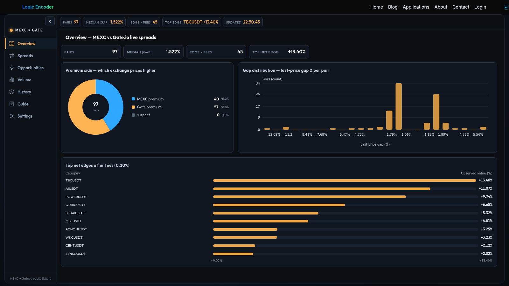

# XEX Spread Monitor

A price difference between exchanges is difficult to assess when each market is viewed separately. XEX Spread Monitor brings shared MEXC and Gate markets into one comparison board, helping users find gaps worth investigating and review them alongside volume and history.

## Tech stack

| Layer | Technologies |
|---|---|
| Core stack | Python; PHP; WordPress; JavaScript; SQLite |

## Compare markets side by side

The spreads view puts the supported exchange prices and their difference into the same row. Sorting and filtering help narrow the list to relevant pairs instead of scanning unrelated markets. It is a screening view, not a promise that a displayed difference can be captured.

A shared row provides a repeatable starting point for comparing the supported exchanges. Narrow the board to the markets relevant to the session before investigating an individual gap.

## Focus on the useful candidates

Opportunity and threshold controls help organise the comparison around the user's interests. Volume context adds another consideration to the price gap. A large displayed spread alone does not establish liquidity, execution quality or a net trading outcome.

Thresholds make the board easier to focus without turning a highlighted value into a trade instruction. Use the surrounding market information to decide which candidates deserve more work.

## Explore volume and history

Dedicated volume and history views help investigate whether the current observation fits a broader pattern. This makes it possible to revisit a candidate with more context than a single snapshot. Comparisons remain limited to the observations available.

History helps distinguish a brief observation from one seen repeatedly. Volume provides another perspective when deciding how to interpret the current difference.

## Keep the board comfortable

Overview, guide and settings areas support repeated use of the monitor. Users can refine display and filtering preferences around the markets they follow. Site administration provides the corresponding controls for checking the published view.

Preferences let the monitor fit the markets and comparisons that matter to its user. The guide and overview remain available when returning after an interruption.

## Reduce repeated checking

The main benefit is bringing the exchange comparison together. Start from the broad board, narrow the candidates and inspect the surrounding activity without rebuilding the comparison in separate tabs. Any decision beyond screening requires its own execution checks.

The workflow is straightforward: scan the shared markets, focus the selection and examine the relevant history. Keeping those stages together makes repeated comparison less laborious.

---

Private code: [xex-spread-bridge](https://github.com/logicencoder/xex-spread-bridge)

See [REPOS.md](REPOS.md) for related repositories.

**[Logic Encoder](https://logicencoder.com)** · [GitHub](https://github.com/logicencoder) · [Contact](https://logicencoder.com/contact/)
