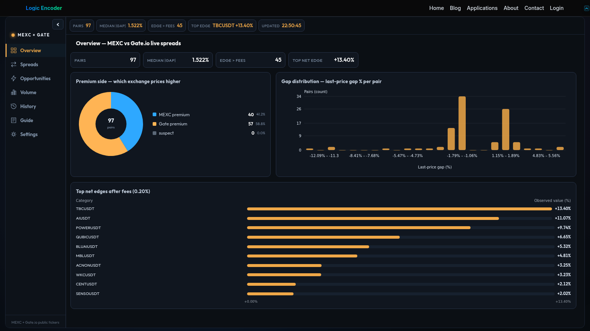

# XEX Spread Monitor

The same coin often trades at slightly different prices on different exchanges, and most of the difference disappears once fees are paid. The XEX Spread Monitor compares every pair that is listed on both MEXC and Gate in USDT, refreshes the comparison every thirty seconds and keeps a log of every snapshot, so a reader can tell a lasting price gap from a one-off glitch and see which gaps are still positive after round-trip fees. It runs on [logicencoder.com](https://logicencoder.com) from public price data.

## Tech stack

| Layer | Technologies |
|---|---|
| Collection | Python worker fetching the all-pairs public tickers of MEXC and Gate every 30 seconds |
| Computation | Shared USDT pairs only, combined 24-hour volume floor, gap as MEXC last price over Gate last price, plausibility cut-off for broken or mismatched tickers |
| History | SQLite log of every snapshot (prices, bids and asks on both sides, gap, direction, both volumes) |
| Delivery | Authenticated REST ingest into a WordPress plugin written in PHP |
| Interface | JavaScript workspace with sortable tables, charts and adjustable fees and liquidity filter |

## Overview

The Overview gives the key numbers of the latest snapshot: how many pairs are listed on both exchanges, the median absolute gap across them, the best net edge after fees, how many pairs still beat round-trip taker fees, the time of the last snapshot in UTC and the number of snapshots in the log. A direction split shows on which exchange the premium sits, and a gap distribution shows how the gaps are spread, so a quiet market and a dislocated one look different at a glance.

## Spreads

Spreads is the full table of shared pairs. Each row shows the route (buy on one exchange, sell on the other), the gross gap, the fees and the net executable edge after round-trip taker fees, the volume of the thinner side and a suspect flag. Any column sorts and the table is paged. A pair is flagged suspect when the two feeds disagree wildly (a gap above a plausibility limit, usually two different assets sharing one ticker) or a tick looks stale; suspect rows are kept in the log but excluded from the opportunities.

## Opportunities

Opportunities lists the pairs where the gap survives taker fees on both legs, ranked by net edge. The fee per side is adjustable in Settings (the default is 0.10% per side), so the same list answers "what is left if my fees are lower or higher". The thinner of the two 24-hour volumes is shown next to each pair because a large gap on a thin market says little about what can actually be traded.

## Volume

The Volume view is the liquidity check: the volume leaders and the gap plotted against liquidity. A wide gap that sits only on low-volume pairs stands apart from one on liquid pairs, and the minimum-volume filter in Settings removes pairs below a chosen level from every table.

## History

History is derived from the monitor's own spread log, which stores every poll cycle since deployment. It shows chronic gaps (pairs that spent most of the last 24 hours with an absolute gap above 0.3%, which points to persistent mispricing rather than a glitch), how long wide gaps survived, and direction flips among chronic pairs, where the premium switches between MEXC and Gate. A gap that vanishes in one cycle and a gap that stays for hours are very different candidates.

## Guide and settings

The Guide defines gap, net edge, fees and the suspect flag. Settings adjust the accent colour, font, density, rows per page, the fee per side and the minimum liquidity, and the chosen values apply to every table and chart on the board. Site administrators also see an ingest log with the latest updates and can regenerate the access key.

## Scope and limits

A displayed gap is the difference between last traded prices. Execution also depends on order-book depth, withdrawal and deposit availability, transfer time and each exchange's own limits, none of which the board models, so the net edge is a screening figure and not a trading outcome. The data is public and shown with its snapshot time.

---

Private code: [xex-spread-bridge](https://github.com/logicencoder/xex-spread-bridge)

See [REPOS.md](REPOS.md) for related repositories.

**[Logic Encoder](https://logicencoder.com)** · [GitHub](https://github.com/logicencoder) · [Contact](https://logicencoder.com/contact/)
